# Classificação da Qualidade de Vinhos Tintos com K-Nearest Neighbors (k-NN)


Projeto acadêmico da disciplina de **Modelos Preditivos Clássicos** (Especialização em Engenharia e Análise de Dados — **CESAR School**), desenvolvido pela **Equipe 04**.

O estudo realiza a Análise Exploratória dos Dados (EDA), o pré-processamento estatístico e a modelagem preditiva supervisionada com o algoritmo **K-Nearest Neighbors (k-NN)** para classificar a qualidade sensorial (`quality`) de vinhos tintos do norte de Portugal a partir de propriedades físico-químicas disponibilizadas pelo [UCI Machine Learning Repository — Wine Quality](https://archive.ics.uci.edu/ml/datasets/wine+quality).

---

## Sumário

1. [Visão Geral e Fluxo Metodológico](#1-visão-geral-e-fluxo-metodológico)
2. [Conjunto de Dados e Dicionário de Variáveis](#2-conjunto-de-dados-e-dicionário-de-variáveis)
3. [Análise Exploratória dos Dados (EDA)](#3-análise-exploratória-dos-dados-eda)
4. [Pré-processamento e Divisão Treino/Teste](#4-pré-processamento-e-divisão-treinoteste)
5. [Escolha do Hiperparâmetro $k$ (Método do Cotovelo)](#5-escolha-do-hiperparâmetro-k-método-do-cotovelo)
6. [Avaliação Comparativa dos Modelos ($k=1$, $k=3$ e $k=11$)](#6-avaliação-comparativa-dos-modelos-k1-k3-e-k11)
7. [Conclusão e Limitações](#7-conclusão-e-limitações)
8. [Estrutura do Repositório](#8-estrutura-do-repositório)
9. [Como Executar](#9-como-executar)
10. [Equipe](#10-equipe)

---

## 1. Visão Geral e Fluxo Metodológico

O pipeline implementado no notebook [`Aula_02_KNN_Wine_Quality.ipynb`](./Aula_02_KNN_Wine_Quality.ipynb) percorre todas as etapas de um experimento clássico de classificação supervisionada multiclasse:

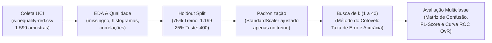

### Principais Destaques do Estudo
- **Integridade dos Dados:** Verificação completa com `missingno` confirmando ausência de valores nulos nas 1.599 observações.
- **Prevenção de *Data Leakage*:** O `StandardScaler` é ajustado (`fit_transform`) exclusivamente no conjunto de treino e apenas aplicado (`transform`) ao conjunto de teste, com validação de reversibilidade via `inverse_transform`.
- **Análise Multiclasse e Probabilística:** Avaliação detalhada além da acurácia global, incorporando relatórios de precisão/recall/F1 por classe, matrizes de confusão e curvas **ROC One-vs-Rest (OvR)** para avaliar a qualidade do ranqueamento probabilístico em diferentes valores de $k$.

---

## 2. Conjunto de Dados e Dicionário de Variáveis

O conjunto de dados utilizado refere-se à variante de **vinho tinto** (*Vinho Verde* do norte de Portugal), obtido diretamente da URL pública da UCI:
- **Fonte:** [`winequality-red.csv`](https://archive.ics.uci.edu/ml/machine-learning-databases/wine-quality/winequality-red.csv)
- **Observações:** 1.599 vinhos
- **Atributos:** 11 variáveis explicativas contínuas (`float64`) e 1 variável alvo discreta (`int64`, notas observadas de 3 a 8).

| # | Variável Original | Descrição em Português | Tipo | Média ± Desvio-Padrão | Mín — Máx |
| :-: | :--- | :--- | :-: | :-: | :-: |
| 1 | `fixed acidity` | Acidez fixa | `float64` | 8,32 ± 1,74 | 4,60 — 15,90 |
| 2 | `volatile acidity` | Acidez volátil | `float64` | 0,53 ± 0,18 | 0,12 — 1,58 |
| 3 | `citric acid` | Ácido cítrico | `float64` | 0,27 ± 0,19 | 0,00 — 1,00 |
| 4 | `residual sugar` | Açúcar residual | `float64` | 2,54 ± 1,41 | 0,90 — 15,50 |
| 5 | `chlorides` | Cloretos | `float64` | 0,087 ± 0,047 | 0,012 — 0,611 |
| 6 | `free sulfur dioxide` | Dióxido de enxofre livre | `float64` | 15,87 ± 10,46 | 1,00 — 72,00 |
| 7 | `total sulfur dioxide` | Dióxido de enxofre total | `float64` | 46,47 ± 32,90 | 6,00 — 289,00 |
| 8 | `density` | Densidade | `float64` | 0,9967 ± 0,0019 | 0,9901 — 1,0037 |
| 9 | `pH` | Potencial hidrogeniônico (pH) | `float64` | 3,31 ± 0,15 | 2,74 — 4,01 |
| 10 | `sulphates` | Sulfatos | `float64` | 0,66 ± 0,17 | 0,33 — 2,00 |
| 11 | `alcohol` | Teor alcoólico (% vol.) | `float64` | 10,42 ± 1,07 | 8,40 — 14,90 |
| **12** | **`quality`** *(Target)* | **Nota sensorial de qualidade (0 a 10)** | `int64` | **5,64 ± 0,81** | **3 — 8** |

---

## 3. Análise Exploratória dos Dados (EDA)

### 3.1. Desbalanceamento entre Classes de Qualidade
Embora a escala teórica vá de 0 a 10, os vinhos avaliados na base concentram-se entre as notas **3 e 8**, com forte predominância das classes intermediárias **5 e 6**, que juntas representam **82,5%** de todo o dataset:

<p align="center">
  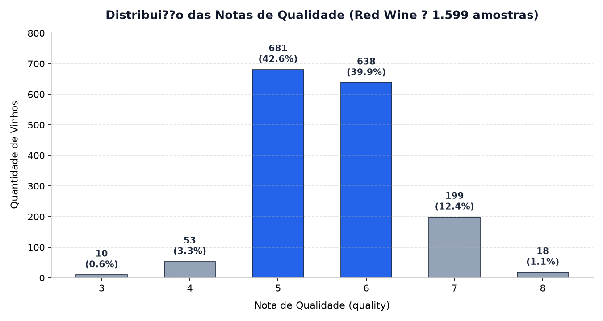
</p>

### 3.2. Distribuição das Variáveis Físico-Químicas
Variáveis como `residual sugar`, `chlorides`, `free sulfur dioxide`, `total sulfur dioxide` e `sulphates` apresentam assimetria positiva (cauda longa à direita), enquanto `density` e `pH` exibem comportamento aproximadamente simétrico/normal:

<p align="center">
  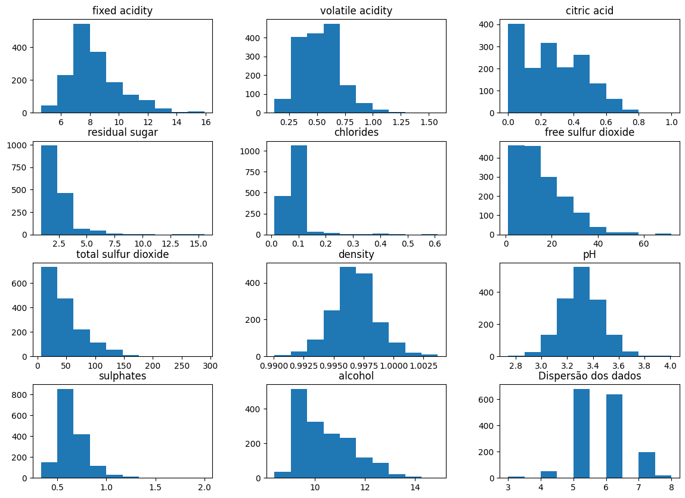
</p>

### 3.3. Correlação Linear e Relação Álcool vs. Densidade
- As variáveis com maior correlação positiva com a qualidade (`quality`) são o **teor alcoólico (`alcohol`, $r = 0{,}48$)**, **sulfatos (`sulphates`, $r = 0{,}25$)** e **ácido cítrico (`citric acid`, $r = 0{,}23$)**.
- A principal correlação negativa ocorre com a **acidez volátil (`volatile acidity`, $r = -0{,}39$)** — níveis elevados de ácido acético conferem sabor avinagrado e reduzem a nota sensorial.

| Correlação com `quality` | Dispersão: Álcool vs. Densidade por Qualidade |
| :-: | :-: |
| 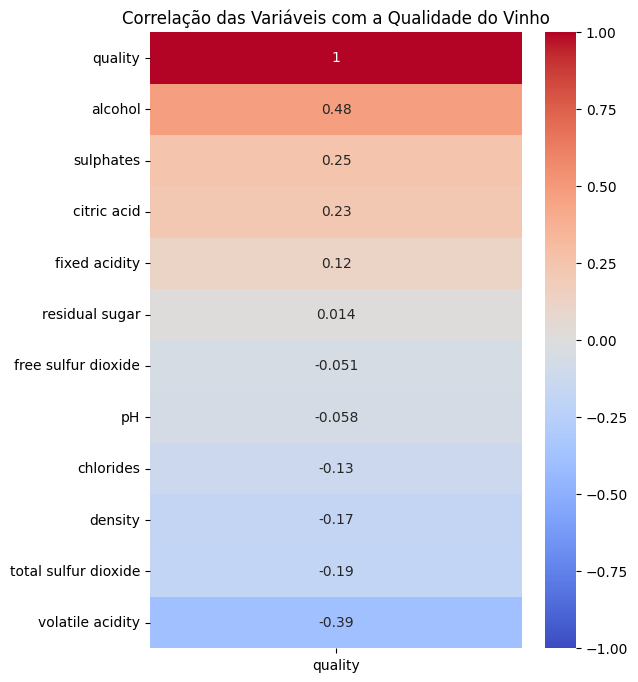 | 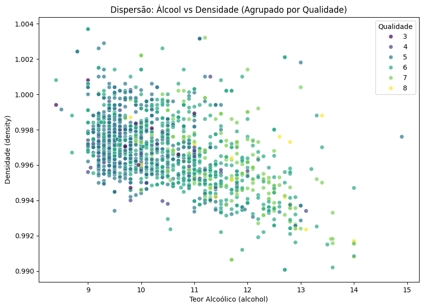 |

---

## 4. Pré-processamento e Divisão Treino/Teste

1. **Separação Holdout (`train_test_split`):**
   - **Treino (75%):** 1.199 amostras (`X_train`, `y_train`)
   - **Teste (25%):** 400 amostras (`X_test`, `y_test`)
   - Semente de reprodutibilidade: `random_state = 111`
2. **Padronização (`StandardScaler`):**
   - Como o algoritmo **k-NN** baseia suas decisões no cálculo de distâncias no espaço multidimensional, atributos em ordens de grandeza maiores (como `total sulfur dioxide`, que chega a 289) dominariam variáveis de pequena escala (como `density` $\approx 0{,}996$ ou `chlorides` $\approx 0{,}087$).
   - Todas as 11 features foram padronizadas para média $\mu = 0$ e desvio-padrão $\sigma = 1$ usando parâmetros estimados estritamente no conjunto de treino.
   - A integridade numérica da transformação foi atestada aplicando `scaler.inverse_transform(X_train_scaled)` e comparando com os dados originais.

---

## 5. Escolha do Hiperparâmetro $k$ (Método do Cotovelo)

Foram treinados e avaliados **40 modelos k-NN** ($k$ variando de $1$ a $40$), registrando a **taxa de erro** ($\text{Error Rate} = \frac{1}{N}\sum [y_i \neq \hat{y}_i]$) e a **acurácia** no conjunto de teste ($N = 400$):

| Taxa de Erro vs. Valor de $K$ | Score (Acurácia) vs. Valor de $K$ |
| :-: | :-: |
| 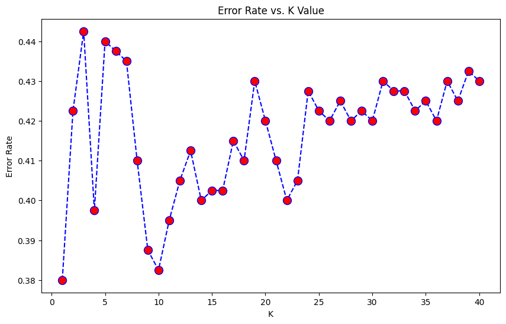 | 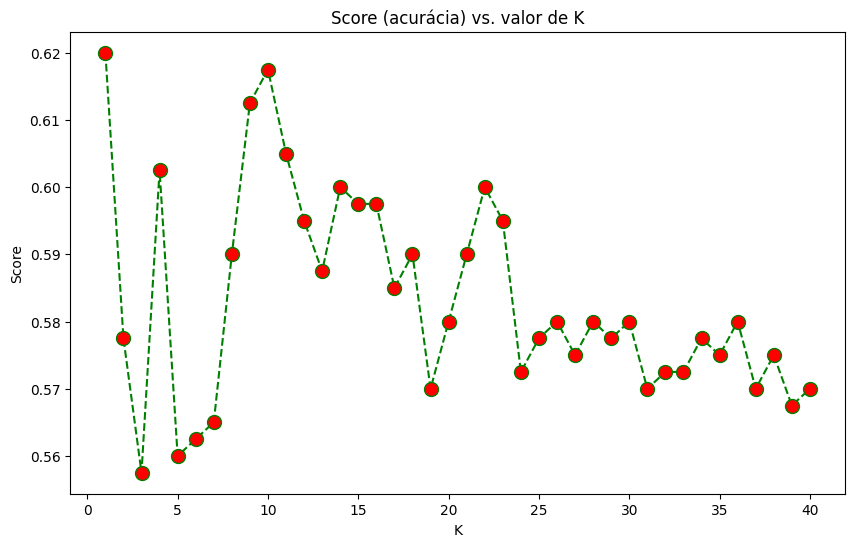 |

### Observações sobre a Curva de $k$
- A taxa de erro oscilou entre **0,380 e 0,440** ao longo de $k \in [1, 40]$.
- Os menores erros nominais ocorreram em **$k = 1$ (erro = 0,380 / acurácia = 62,0%)**, seguido de perto por **$k = 10$ (erro $\approx 0{,}383$ / acurácia = 61,75%)**, **$k = 9$ (erro $\approx 0{,}388$ / acurácia = 61,25%)** e **$k = 11$ (acurácia = 60,5%)**.
- Diferenças de $0{,}005$ a $0{,}015$ na acurácia equivalem a apenas **2 a 6 vinhos** dentre os 400 avaliados no teste. Para $k > 24$, a acurácia cai e estabiliza em torno de 57%–58%.

---

## 6. Avaliação Comparativa dos Modelos ($k=1$, $k=3$ e $k=11$)

Para investigar o equilíbrio entre acurácia pontual, suavização da fronteira de decisão e capacidade de ranqueamento probabilístico (**AUC ROC One-vs-Rest** para a classe majoritária `quality = 5`), foram comparados em detalhe os modelos com **$k=1$**, **$k=3$** e **$k=11$**:

<p align="center">
  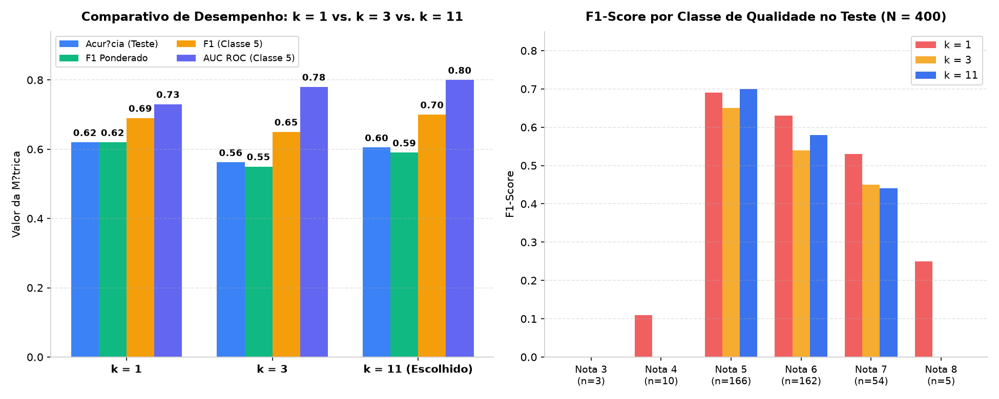
</p>

### 6.1. Tabela Resumo de Métricas no Conjunto de Teste ($N = 400$)

| Métrica | $k = 1$ | $k = 3$ | $k = 11$ *(Escolhido)* | Interpretação |
| :--- | :-: | :-: | :-: | :--- |
| **Acurácia Geral** | **0,620** | 0,562 | 0,605 | Diferença entre $k=1$ e $k=11$ é de apenas 6 amostras no teste |
| **F1-Score (Weighted Avg)** | **0,620** | 0,550 | 0,590 | Sustentado pelas classes majoritárias 5, 6 e 7 |
| **F1-Score (Macro Avg)** | **0,370** | 0,270 | 0,290 | Reflete o baixo suporte das classes extremas (3, 4 e 8) |
| **F1-Score — Classe 5** *(n=166)* | 0,690 | 0,650 | **0,700** | **Melhor recall (0,74) e F1 (0,70) alcançados em $k=11$** |
| **F1-Score — Classe 6** *(n=162)* | **0,630** | 0,540 | 0,580 | Maior sobreposição química com a nota 5 |
| **F1-Score — Classe 7** *(n=54)* | **0,530** | 0,450 | 0,440 | Perde sensibilidade conforme $k$ aumenta devido ao menor suporte |
| **AUC ROC OvR (Classe 5 vs. Resto)** | 0,73 | 0,78 | **0,80** | **Melhor ranqueamento de probabilidades em $k=11$** |

### 6.2. Matrizes de Confusão ($k=1$, $k=3$ e $k=11$)

| $k = 1$ | $k = 3$ | $k = 11$ |
| :-: | :-: | :-: |
| 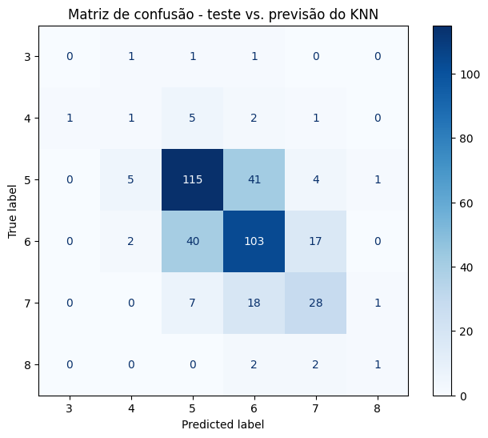 | 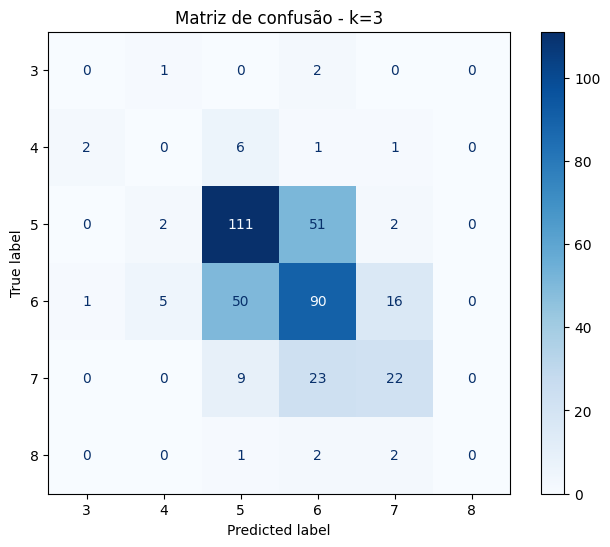 | 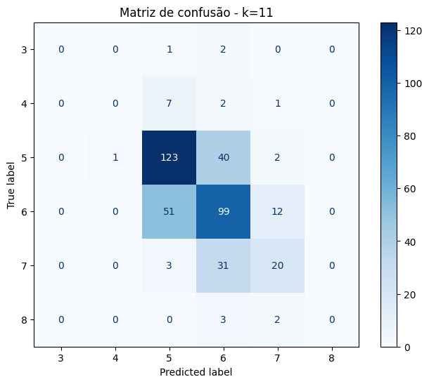 |

### 6.3. Curvas ROC One-vs-Rest — Classe 5 vs. Demais ($k=1$, $k=3$ e $k=11$)

| $k = 1$ ($\text{AUC} \approx 0{,}73$) | $k = 3$ ($\text{AUC} \approx 0{,}78$) | $k = 11$ ($\text{AUC} \approx 0{,}80$) |
| :-: | :-: | :-: |
| 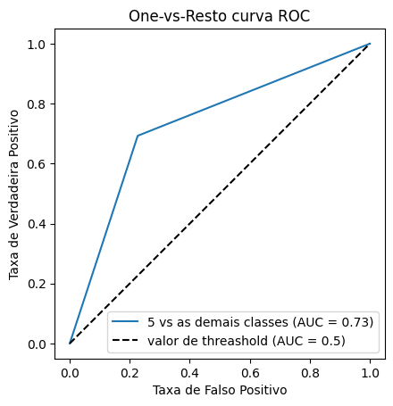 | 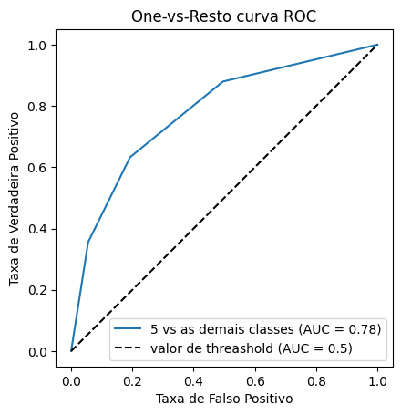 | 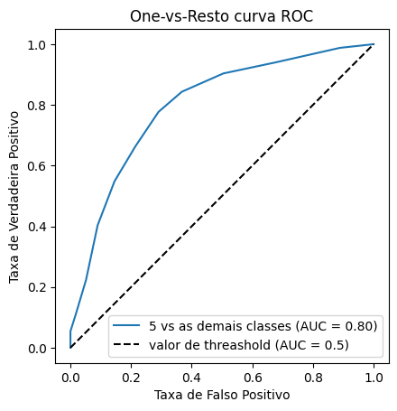 |

---

## 7. Conclusão e Limitações

1. **Por que $k = 11$ foi adotado como a escolha mais equilibrada?**
   - Embora **$k = 1$** apresente a maior acurácia numérica bruta (62,0%), o classificador de vizinho único é altamente sensível a ruídos locais e possíveis duplicatas na amostra, além de produzir probabilidades degeneradas ($0$ ou $1$), resultando na menor área sob a curva ROC ($\text{AUC} = 0{,}73$).
   - À medida que $k$ aumenta, o **ranqueamento probabilístico melhora consistentemente**: a AUC da classe 5 evolui de **$0{,}73$ ($k=1$)** para **$0{,}78$ ($k=3$)** e atinge **$0{,}80$ em $k=11$**, ao mesmo tempo em que o F1-score da classe 5 atinge seu pico ($0{,}70$, com recall de $0{,}74$) e a acurácia global ($60{,}5\%$) permanece estatisticamente próxima do ótimo.
2. **Impacto do Desbalanceamento de Classes:**
   - A distância entre o *Weighted Avg F1* ($0{,}59$–$0{,}62$) e o *Macro Avg F1* ($0{,}27$–$0{,}37$) decorre da escassez de exemplos nas classes extremas dentro do conjunto de teste: apenas **3 vinhos de nota 3**, **10 vinhos de nota 4** e **5 vinhos de nota 8**. Em vizinhanças maiores ($k=11$), os votos das classes massivas (5 e 6) absorvem naturalmente as regiões de baixa densidade.

---

## 8. Estrutura do Repositório

```text
├── assets/                                  # Gráficos extraídos do estudo e painéis comparativos
│   ├── correlacao_qualidade.png
│   ├── curva_roc_k1.png
│   ├── curva_roc_k3.png
│   ├── curva_roc_k11.png
│   ├── dispersao_alcool_densidade.png
│   ├── distribuicao_classes_qualidade.png
│   ├── histogramas_variaveis.png
│   ├── matriz_confusao_k1.png
│   ├── matriz_confusao_k3.png
│   ├── matriz_confusao_k11.png
│   ├── metodo_cotovelo_erro_k.png
│   ├── painel_comparativo_knn.png
│   └── score_acuracia_k.png
├── Aula_02_KNN_Wine_Quality.ipynb               # Notebook principal com código, EDA, modelagem e conclusões
├── .gitignore                               # Exclusão de ambientes virtuais, caches e credenciais
├── requirements.txt                         # Dependências Python necessárias para reprodução
└── README.md                                # Documentação detalhada e visual do projeto
```

---

## 9. Como Executar

Recomendado: **Python 3.10** ou superior.

1. Clone este repositório e acesse o diretório do projeto:
   ```bash
   git clone https://github.com/pepsbr/projeto-02-modelos-preditivos-classicos-knn-wine.git
   cd projeto-02-modelos-preditivos-classicos-knn-wine
   ```
2. Crie e ative um ambiente virtual Python:
   ```bash
   python -m venv .venv
   # Windows (PowerShell)
   .\.venv\Scripts\Activate.ps1
   # Linux / macOS
   source .venv/bin/activate
   ```
3. Instale as dependências:
   ```bash
   python -m pip install -r requirements.txt
   ```
4. Inicie o Jupyter Notebook e execute as células em ordem:
   ```bash
   jupyter notebook Aula_02_KNN_Wine_Quality.ipynb
   ```
   > **Nota:** O dataset é carregado diretamente via HTTPS a partir do repositório oficial da UCI (`archive.ics.uci.edu`), não sendo necessário baixar arquivos CSV manualmente.

---

## 10. Equipe

Trabalho desenvolvido pela **Equipe 04** — CESAR School:

- **Mauro Roberto Barbosa Cahu**
- **Pedro Paulo Sant'Anna Belo Ramos**
- **Renato Vasconcellos Bittencourt Neto**
- **Vinicius Dantas Batista da Silva**
